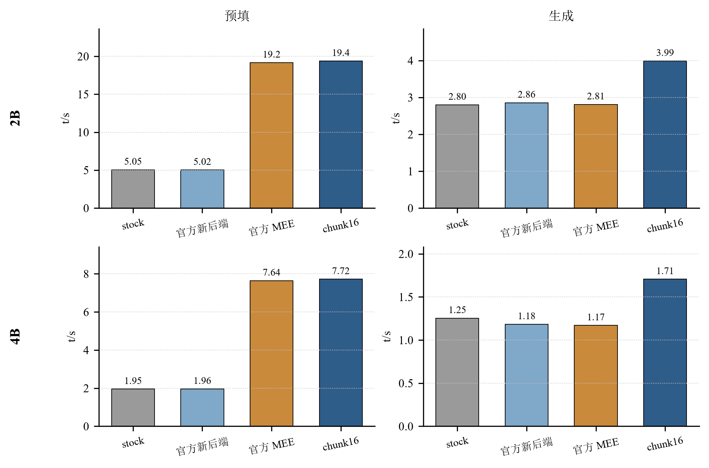
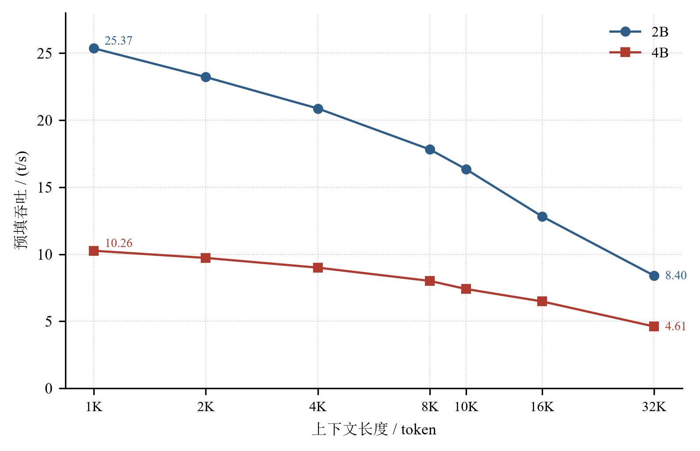

# 参赛项目方案书

**赛道**：CIE 全国 RISC-V 高水平创新及应用大赛（第二届）· 进迭时空 RISC-V 应用创新赛道
**赛题**：赛题二 —— 基于 K1 AI CPU 的大模型部署落地
**项目**：Qwen3.5-2B/4B 在 SpacemiT K1 上的本地部署与性能优化
**日期**：2026-11-08

---

## 摘要

本项目面向工业现场的离线智能值守场景，在 SpacemiT K1（8×X60，8 GB LPDDR4X）上完成 Qwen3.5-2B/4B 的本地部署与性能优化。K1 缺少 `vmadot` 点积指令，矩阵引擎仅覆盖 4 个核心且只支持特定数据格式，直接部署时 2B 预填约 5 t/s、生成约 2.8 t/s，4B 预填约 2 t/s、生成约 1.3 t/s，首 token 超过 7 秒（2B）与 18 秒（4B），难以支撑实际业务。

项目从量化方案、内核实现、线程调度与长上下文管理四个层面进行改造，全部工作基于官方 `spacemit-com/llama.cpp` 分支。交付构建的预填吞吐达到 2B 25.29 t/s（8 板中位）、4B 9.84 t/s（3 板中位），相对官方 Q4_1 格式基线为 5.04× 与 5.02×（部署口径；同模型同板四臂为 3.86× 与 3.94×）；生成吞吐为 2B 3.91 t/s、4B 2.01 t/s；首 token 时延相对 stock 构建降低 28.9%—42.6%；与厂商矩阵引擎同板对比，预填处于同一水平，生成领先 41.9% / 45.8%。

项目同时公开完整的负结果、适用边界与可复验证据链：97 条 claim、307 条归档实验，每条数字绑定证据文件与 SHA256。

**关键词**：RISC-V；K1；大语言模型推理；量化；RVV；长上下文

---

## 一、引言

### 1.1 背景

工业现场的离线智能值守要求在断网、数据不出厂的条件下完成设备报警处置、巡检报告生成与长文档问答。此类场景对硬件成本敏感，通常以千元级边缘设备为部署目标。SpacemiT K1 具备 8 核 RISC-V、256-bit RVV 与 2 TOPS 矩阵引擎，算力足以支撑 2B—4B 量级模型，但软件栈的算子覆盖与调度策略仍不充分。

### 1.2 问题

在 K1 上部署 Qwen3.5 面临三项约束：

1. **缺少 `vmadot`**：RVV 点积需拆分为乘加序列，生成阶段的主要算子 GEMV 难以获得理想吞吐；
2. **矩阵引擎覆盖有限**：`ime` 仅在 cpu0—cpu3 可用，且只支持 `i8i4`/`i8i8` 格式，社区常用的 Q4_0、Q4_K_M 无法直接利用；
3. **内存带宽受限**：实测可持续带宽约 8.17 GB/s，生成阶段每 token 需完整读取权重（2B 1.20 GB、4B 2.54 GB），物理上限决定生成速度的量级。

### 1.3 目标

在保持官方模型能力不变的前提下，使 2B/4B 模型在 K1 上达到“工业离线值守可用”的档位，并对每一项性能提升给出可复现的归因。

### 1.4 贡献

1. 一套面向 K1 的量化与内核方案：自量化 Q4_0 配方、RVV 16×1 repack、CONCAT 快速路径、GQA 折叠与 chunk16 分块，共 7 个补丁、1876 行新增代码；
2. 一套可复现的测量方法：同板 ABBA、多板中位与四分位距、冷启动与缓存命中分离、证据文件与 SHA256 绑定；
3. 对四个层面的逐层归因：同板四臂对照、2×2 分解与 stock A/B；
4. 一套完整的长上下文数据：1K—10K 官方口径曲线、4K—32K 同板曲线、KV 槽位复用与同文档换问题的无损复用。

### 1.5 赛题要求对应

**表 1 赛题要求与本方案的对应关系**

| 赛题要求 | 本方案对应内容 | 位置 |
|---|---|---|
| 2B/4B 两个规格均为基础要求 | 两模型均完成本地部署与测量 | 第 2、3 节 |
| 部署工具必须使用进迭时空开源 llama.cpp | 基于 `spacemit-com/llama.cpp`，7 个补丁 | 2.3 节 |
| 两模型支持本地推理、不依赖云端 API | 全部推理在板端完成 | 2.1 节 |
| 提供 baseline 与优化版结果、至少一项可量化优化 | 同板四臂、stock A/B、逐层分解 | 3.2 节、表 2 |
| 完整部署说明、运行脚本和测试结果 | 部署与复现文档、四个脚本、技术报告 | `03_部署与复现/`、`02_技术报告/` |
| 进阶：prefill 持续优化 | 25.29 / 9.84 t/s，对官方格式基线 5.04× / 5.02×（四臂 3.86× / 3.94×） | 3.1 节 |
| 进阶：decode 持续优化 | 3.91 / 2.01 t/s；t7/t8 解耦、四路并发、KV 复用 | 2.4、2.5 节 |
| 进阶：长上下文吞吐、内存、KV 开销 | 1K—32K 曲线；RSS 稳态 1990—2008 MB；KV 落盘 0.70 s 复用 | 3.3 节 |
| 进阶：量化、KV 压缩、调度、llama.cpp 改造 | 自量化配方、KV 槽位存盘、线程解耦、7 个补丁 | 2.2—2.5 节 |

> 关于模型命名：赛题文本写作 `Qwen3.5-2B-Instruct` / `Qwen3.5-4B-Instruct`，官方模型包（`Qwen/Qwen3.5-2B`、`Qwen/Qwen3.5-4B`）即指令微调版本，材料按官方文件名书写，未作改名。

---

## 二、技术实现

### 2.1 总体架构

部署链由三段组成：官方权重转 f16 GGUF、量化生成 Q4_0 交付模型、带补丁的 llama.cpp 在板端加载。全部推理在板端完成，不依赖云端服务。

### 2.2 量化方案

官方发布的 Q4_1 权重为混合格式：2B 模型包含 186 个 Q4_1、1 个 Q6_K 词嵌入与 133 个 F32 张量，输出头所在的词嵌入占参数约 27%，不在 repack 覆盖范围内。交付配方为：主体采用 Q4_0，使线性层落入 repack 快路径；`token_embd` 保留 Q6_K，避免输出头精度损失。

质量代价以困惑度衡量：小语料下 2B 相对第三方混合配方高 4.44%，4B 高 3.53%；扩语料为 4.06% 与 5.56%；跨域语料 2B 为 −1.36%，4B 为 +7.89%。

### 2.3 内核改造

**Q4_1 repack**。将 32 权重一块的原始布局重排为 16×1 的向量友好布局，使一次 256-bit 向量乘加可处理 16 个权重，并将缩放因子与最小值预取到连续内存。新增 374 行，在官方 Q4_1 格式上实现 2B 3.70×、4B 3.65× 的预填提升（旧构建口径）。

**CONCAT 快速路径**。为连续内存的拼接场景增加快速路径，消除中间缓冲区，预填提升约 17%，新增 29 行。

**GQA 折叠**。将同一 KV 头的多个查询头输出折叠后统一计算，减少重复读取；生成深度 0 约 +1.2%，8K 深度历史单板 +6.3%，上游 master 复测边际不显著，不计入主要归因。新增 154 行。

**chunk16 分块**。将 `GGML_CPU_CHUNK_MULT` 从默认 4 提升至 16，使一次权重读取服务 16 个 token 的计算，预填提升 20.8%（2B）与 36.7%（4B），输出逐字节不变、PPL 变化为 0。新增 15 行。

**K-quant repack**。将 repack 思路扩展到 Q5_K、Q6_K、Q3_K，新增 549、300、455 行；三套实现在上游 master 0.7.0 上内核逻辑零改动，Q4_K_M 格式预填从 6.893 提升至 13.686 t/s（+98.5%）。

### 2.4 调度与并发

预填使用 8 个线程，生成退至 7 个线程（`-t 7 --threads-batch 8`），避免生成阶段的缓存争用；在 8 GB 板上以 `-np 4` 开启四路并发，使一次权重读取服务四个请求。2B 四路聚合相对串行提升 24.0%，4B 短输出臂提升 31.5%、长输出臂提升 14.6%。

### 2.5 长上下文与 KV 复用

长上下文处理包含三项机制：以 `-ub 128`、`-b 2048` 控制分块预填；将 6077 token 提示的 KV 状态落盘（135.6 MB），恢复耗时 240.7 ms，同一提示再次请求的预填从 276.2 s 降至 0.698 s；同一文档换问题时从最近 checkpoint 恢复并重算约 512 token，时延 26.6—27.3 s，输出与冷启动逐字节一致。

### 2.6 部署

交付物为一个二进制 tar 包（7.2 MB）与一个源码包（38.6 MB，可重编），配合编译、量化、部署、验证四个脚本，单板部署约 5 分钟。

---

## 三、技术分析

### 3.1 性能结果

**表 2 主要性能指标**

| 指标 | 2B | 4B |
|---|---:|---:|
| 预填吞吐（t/s） | 25.29（8 板中位） | 9.84（3 板中位） |
| 生成吞吐（t/s） | 3.91（t8@512）/ 4.37（t7 零深度） | 2.01（t7 零深度） |
| 首 token 128 token（s） | 5.05 | 12.81 |
| 首 token 512 token（s） | 19.49 | 49.47 |
| 首 token 1024 token（s） | 40.15 | 99.56 |
| 首 token 相对 stock 降幅 | 28.9%—41.6% | 30.7%—42.6% |
| 固定测试集覆盖 / 通过 | 0.75 / 45% | 0.875 / 70% |

> 固定测试集两列是 2026-10-29 的测量；**2026-11-08 用包内判分脚本在交付构建上复算（20 题 × 1 轮）为 2B 0.683 / 35%、4B 0.921 / 80%**。
> 差异来自构建迭代导致的 greedy 输出变化，已用同一二进制改 `GGML_CPU_CHUNK_MULT`（4 vs 16）验证分块补丁不是原因。

### 3.2 归因分析

同板四臂对照（官方 Q4_1、t8、ABBA 两轮）见表 3 与图 1。

**表 3 同板四臂结果**

| 臂 | 2B 预填 | 2B 生成 | 4B 预填 | 4B 生成 |
|---|---:|---:|---:|---:|
| stock | 5.05 | 2.80 | 1.95 | 1.25 |
| 官方新后端 | 5.02 | 2.86 | 1.96 | 1.18 |
| 官方 MEE | 19.16 | 2.81 | 7.64 | 1.17 |
| 交付构建 | **19.38** | **3.99** | **7.72** | **1.71** |

结论有三：

1. 官方新后端对 Qwen3.5 不加速（相对 stock −0.5% / +0.4%），真正有效的加速路径是 MEE 与 repack；
2. 交付构建的预填与 MEE 处于同一水平（+1.15% / +1.02%），说明自研内核已追平厂商矩阵引擎；
3. 交付构建的生成领先 MEE 41.9% / 45.8%，原因是矩阵引擎无法用于 GEMV 类算子。

进一步以 stock A/B 量化纯补丁贡献：2B 首 token 降低 28.9%—41.6%，4B 降低 30.7%—42.6%（各 4 板、12/12 格一致）。

### 3.3 长上下文

1K—10K 的官方递增口径下，2B 预填从 25.37 降至 16.34 t/s（−35.6%），4B 从 10.26 降至 7.41 t/s（−27.8%）；4K—32K 的同板补充测量中，2B 为 20.70/17.35/12.82/8.40，4B 为 9.29/8.11/6.48/4.61。曲线单调、无悬崖，但相对衰减比同板 stock 更陡（ΔD 为 −6.44 / −8.58 个百分点），本项目不声称改善衰减斜率。

### 3.4 正确性与质量

- 困惑度：小语料 +4.44% / +3.53%，扩语料 +4.06% / +5.56%，跨域 −1.36% / +7.89%（相对第三方混合配方）；
- 固定测试集（20 题、关键词判分、≥0.8 记通过）：2B 覆盖 0.75、通过 45%，4B 覆盖 0.875、通过 70%；
- 确定性：同一提示两次生成逐字节一致；KV 复用与同文档复用的输出与冷启动逐字节一致；
- 证据链：97 条 claim 绑定证据文件与 SHA256，可通过脚本复验。

### 3.5 边界

1. 长上下文相对衰减未改善，4K→32K 为 −59.4%（2B）/ −50.4%（4B）；
   > 该组为 `-fa auto` 口径。显式 `-fa 0` 同板复测 2B 32K = **10.78 t/s**（8.40 → +28.3%）、衰减 **−52%**；4B 无同板对照，维持 `-fa auto`。详见技术报告 6.3。
2. 4B 生成相对 stock 仅 +3.0%，受 8.17 GB/s 带宽限制；
3. 4B 32K 单次预填需 7111 s（约 119 分钟），仅作压力数据；
4. 质量存在约 4%—5.6% 的困惑度代价，属速度与质量的取舍。

---

## 四、市场分析

### 4.1 目标场景

工业现场的离线智能值守：设备报警后的处置建议、巡检报告生成、SOP/图纸长文档问答。该场景有三项硬约束：不能依赖云（产线网络隔离、数据不出厂）；可接受 10—30 秒的报警响应与 1—3 分钟的巡检报告，但不能长时间无响应；单工位硬件成本需控制在千元级。

### 4.2 市场时机

模型侧，Qwen3.5-2B/4B 的中文指令跟随与工业文本理解已满足上述场景，2B 可运行于 8 GB 内存设备；芯片侧，K1 等 8 核 RISC-V 设备将“能跑”变为“买得起”，并支持工业温区；合规侧，数据本地化与供应链国产化要求使云端 API 方案在部分场景不可行。

### 4.3 竞争格局

**表 4 竞争路线对比**

| 路线 | 优势 | 局限 | 本项目差异 |
|---|---|---|---|
| 云端大模型 API | 效果最好、零运维 | 断网不可用、数据出厂合规风险、按 token 计费 | 完全离线，一次部署零边际成本 |
| 边缘 GPU 设备 | 吞吐高 | 成本与功耗高、非工业级 | 单板千元级、被动散热、工业温区 |
| 同价位 ARM 设备 | 生态成熟 | 国产化要求下不占优、带宽通常更低 | RISC-V 自主指令集与可复现优化 |
| 其他 K1 方案 | — | 多数仅报告“能跑”，缺少同板对照与证据链 | 每个数字有证据文件与 SHA256 |

### 4.4 典型场景

**表 5 典型场景与指标**

| 场景 | 现状 | 本项目形态 | 关键指标 |
|---|---|---|---|
| 设备报警处置 | 查阅手册、咨询资深人员，10—30 分钟 | 报警文本与最近参数输入，20 秒内给出处置步骤 | 首 token 5.05 s（2B）/ 12.81 s（4B） |
| 班次巡检报告 | 手工编写 20—40 分钟/班 | 数据与模板输入，2 分钟内生成结构化报告 | 512 token 首 token 19.49 s（2B） |
| 长文档问答 | 每次重新检索 | 首次预填后缓存，后续提问秒级响应 | 同提示 0.70 s；同文档换问题 26.6—27.3 s |

### 4.5 团队基础

团队已有一台运行中的 K1 工业监控样机：四层架构、MCP 与 Modbus 接入、连续运行 24 小时采集 108,001 条样本、采集完整率 100%、控制指令平均往返 29.5 ms；样机物料成本约 2,289 元。另有期刊初稿一项：自然语言到控制指令的闭环，600 条测试指令识别正确率 95.50%、端到端响应 1.35 s。前序系统的本地模型为 0.6B 级，本项目将其提升至 2B/4B。

---

## 五、价值评估

### 5.1 客户价值

以班次巡检报告为例：每条产线每班 1 份、人工 30 分钟、三班倒 365 天，合计 1095 份/线/年；按 40 元/小时计，年人力成本 21,900 元。采用 K1 终端后，单份耗时降至 7 分钟（生成 2 分钟、复核 5 分钟），年人力成本 5,110 元，单线年节省约 1.68 万元；终端按 1,500 元计，回本周期约 1.1 个月。

上述计算为假设—计算示例，实际收益取决于产线数量与人工单价。

### 5.2 生态价值

1. 一个可复现的 RISC-V 边缘 AI 参考实现：从官方权重、量化配方、内核补丁到部署与测试口径全部公开；
2. 7 个补丁，其中 Q5_K/Q6_K/Q3_K 三个回馈上游，Q5_K 使社区常用的 Q4_K_M 格式在 RISC-V 上预填提升 98.5%（上游 master 口径）；
3. 一套可复用的测量方法：同板 ABBA、多板中位与 IQR、证据文件与 SHA256 绑定。

### 5.3 评审价值

- 可验证：`verify_claims.py` 一条命令校验 97 条 claim；
- 可复现：四个脚本，可在独立板卡上跑通；
- 可对比：同时给出官方 MEE、社区默认、交付构建三组同板数据。

### 5.4 风险与边界

**表 6 风险与缓解**

| 风险 | 说明 | 缓解 |
|---|---|---|
| 生成速度偏低 | 2B 3.91/4.37 t/s、4B 2.01 t/s，不适合实时对话 | 产品形态为“提交任务、等待结果”，配合缓存将重复提问降至 0.5—0.7 s |
| 长上下文衰减 | 4K→32K 为 −59.4% / −50.4% | 只承诺单调、可预测、无悬崖，公开完整曲线 |
| 质量代价 | 困惑度相对第三方高 4%—5.6% | 提供质量优先配置（Q4_K_M + Q5_K），在文档中写明取舍 |
| 硬件依赖 | 仅在 K1 8 GB 验证 | 脚本与补丁与硬件解耦，可移植至同指令集平台 |
| 官方长度未公布 | 官方 10 个来源均未给出规定长度 | 覆盖 8K/16K/32K 并公开曲线 |

---

## 六、结论与交付物

本项目在 K1 上完成了 Qwen3.5-2B/4B 的部署与优化。预填吞吐 25.29 / 9.84 t/s，相对官方格式基线 5.04× / 5.02×（四臂口径 3.86× / 3.94×）；生成吞吐 3.91 / 2.01 t/s；首 token 时延相对 stock 降低 28.9%—42.6%；长上下文在 32K 内保持单调；同文档换问题复用时延 26.6—27.3 s 且输出无损。全部数字绑定证据文件与 SHA256，可通过仓库脚本复验。

**表 7 交付物**

| 交付物 | 位置 |
|---|---|
| 可运行代码（01—03 已合入，04—07 见 patches） | `07_源码与二进制/llama-src-final-717a8ad8.tar.gz` |
| 二进制与库 | `07_源码与二进制/llama-bin-chunk16-4436a9f4.tar.gz` |
| 编译、量化、部署、验证脚本 | `03_部署与复现/scripts/` |
| 部署与复现说明 | `03_部署与复现/03_部署与复现.md` |
| 性能测试报告 | `02_技术报告/02_技术报告.pdf` |
| 固定测试集 | `05_模型与测试集/工业监控固定测试集_v1.json` |
| 代码与文档仓库（可选） | https://github.com/suhongkai/rvv-perf-notes（公开） |
| 模型文件（2B/4B） | 百度网盘 `模型_网盘交付_2026-11-08.7z`：`https://pan.baidu.com/s/1ya0FF80mw-qsCm6SydcUgA?pwd=qcnw`（提取码 `qcnw`）；SHA256 见 `05_模型与测试集/05_模型与测试集.md` §2 |

---

*本方案书所有性能数字来自 `08_证据与复验/claims.json`（97 条，逐条绑定证据文件与 SHA256），口径以技术报告为准。*
