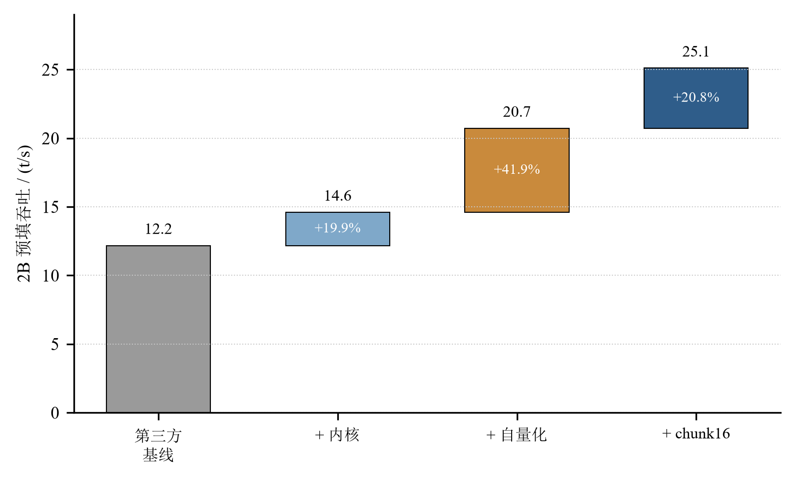
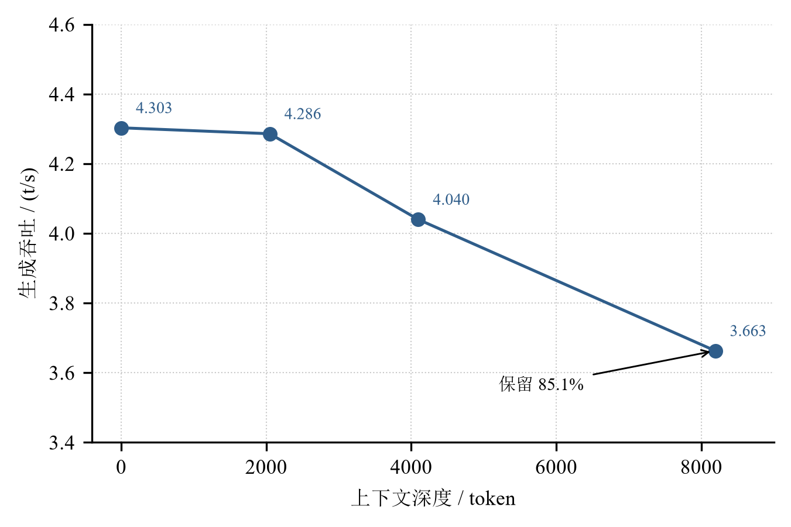
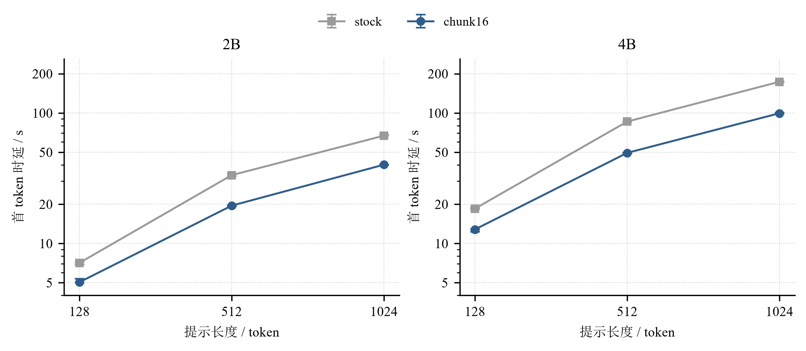
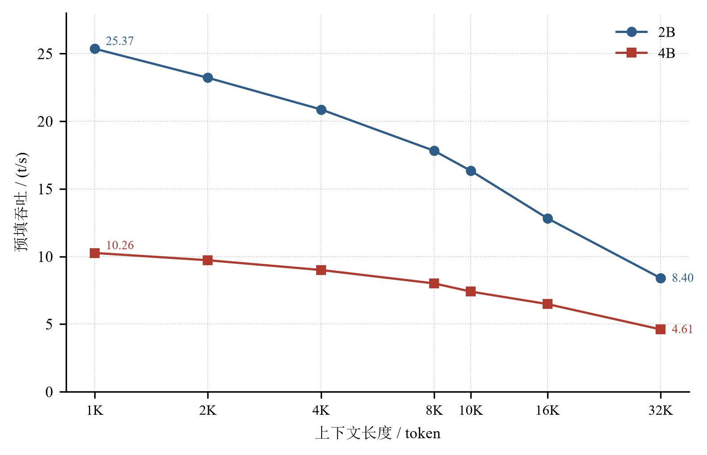
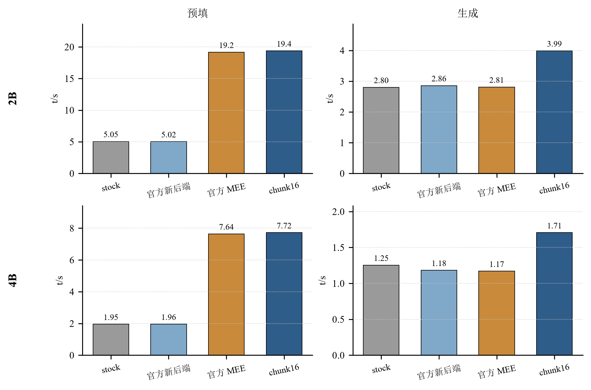

# 基于 K1 AI CPU 的 Qwen3.5-2B/4B 本地部署与性能优化

**技术报告**

赛道：CIE 全国 RISC-V 高水平创新及应用大赛（第二届）· 进迭时空赛道
赛题：赛题二 —— 基于 K1 AI CPU 的大模型部署落地
日期：2026-11-08

---

## 摘要

本文研究 Qwen3.5-2B 与 Qwen3.5-4B 在 SpacemiT K1（8×X60，8 GB LPDDR4X）上的本地推理性能优化。K1 具备 256-bit RVV 与 2 TOPS 矩阵引擎，但缺少 `vmadot` 点积指令，且矩阵引擎仅覆盖 4 个核心，难以直接支撑大语言模型的高效推理。本文从量化方案、内核实现、线程调度与长上下文管理四个层面进行改造，全部工作基于官方 `spacemit-com/llama.cpp` 分支，不引入新的推理框架。

在相同模型、相同板卡、ABBA 两轮的对照下，交付构建的预填吞吐达到 2B 25.29 t/s（8 板中位）与 4B 9.84 t/s（3 板中位），相对官方 Q4_1 格式基线为 5.04× 与 5.02×（部署口径；同模型同板四臂为 3.86× 与 3.94×）；生成吞吐达到 2B 3.91 t/s（t8@512）与 4B 2.01 t/s（t7 零深度）。与厂商矩阵引擎（MEE）同板对比，预填处于同一水平（+1.15% / +1.02%），生成领先 41.9% / 45.8%。首 token 时延在 128/512/1024 token 提示下分别为 2B 5.05/19.49/40.15 s、4B 12.81/49.47/99.56 s，相对 stock 构建降低 28.9%—42.6%。长上下文方面，2B 与 4B 在 4K—32K 范围内保持单调衰减，32K 预填分别为 8.40 与 4.61 t/s；同一文档换问题时，从第二个问题起仅需重算约 512 token，时延 26.6—27.3 s，且输出与冷启动逐字节一致。

本文同时给出完整的负结果与适用边界，所有对外数字均绑定证据文件与 SHA256（97 条 claim、307 条归档实验），可通过仓库内脚本独立复验。

**关键词**：RISC-V；K1；大语言模型推理；量化；RVV；llama.cpp；长上下文

---

## 1 引言

### 1.1 研究背景

面向工业现场的离线智能值守要求在断网、数据不出厂的条件下完成设备报警处置、巡检报告生成与长文档问答。此类场景对硬件成本敏感，通常以千元级边缘设备为部署目标。SpacemiT K1 是当前少数具备 8 核 RISC-V、256-bit RVV 与 2 TOPS 矩阵引擎的国产 SoC，其算力足以支撑 2B—4B 量级模型的推理，但软件栈的成熟度与算子覆盖仍不充分。

### 1.2 问题定义

在 K1 上部署 Qwen3.5 面临三个具体约束：

1. **缺少 `vmadot`**。RVV 的向量点积需拆分为乘加序列，生成阶段的主要算子 GEMV 难以获得理想吞吐。
2. **矩阵引擎覆盖有限**。`ime` 指令仅在 cpu0—cpu3 可用，且只支持 `i8i4`/`i8i8` 数据格式；社区常用的 Q4_0、Q4_K_M 等格式无法直接利用。
3. **内存带宽受限**。实测可持续带宽约 8.17 GB/s，生成阶段每 token 需完整读取权重，2B 模型 1.20 GB、4B 模型 2.54 GB，物理上限决定了生成速度的量级。

上述约束意味着预填与生成需要采用不同的优化路径：预填受算力约束，生成受带宽约束。

### 1.3 主要贡献

本文的贡献包括：

1. 一套面向 K1 的量化与内核方案：自量化 Q4_0 配方（共享词嵌入保留 Q6_K）、RVV 16×1 repack、CONCAT 转置快速路径、GQA 折叠与 chunk16 分块，共 7 个补丁、1876 行新增代码。
2. 一套可复现的测量方法：同板 ABBA、多板中位与四分位距、冷启动与缓存命分离、证据文件与 SHA256 绑定。
3. 对四个层面的逐层归因：同板四臂对照（stock / 官方新后端 / 官方 MEE / 交付构建）、2×2 分解与 stock A/B，明确每一项增益的来源。
4. 一套完整的长上下文数据：1K—10K 官方口径曲线、4K—32K 同板曲线、KV 槽位复用与同文档换问题的无损复用。

### 1.4 报告结构

第 2 节介绍平台与背景；第 3 节描述方法；第 4 节给出实验设置；第 5 节报告结果；第 6 节讨论机理与边界；第 7 节分析有效性威胁；第 8 节总结。附录给出复现步骤与证据索引。

---

## 2 平台与背景

### 2.1 硬件与软件栈

实验平台为 MUSE Pi Pro（SpacemiT K1），主要参数见表 1。

**表 1 实验平台参数**

| 项目 | 参数 |
|---|---|
| SoC | SpacemiT K1，8 × X60 @ 1.6 GHz |
| 内存 | 8 GB LPDDR4X-2400 |
| 向量扩展 | RVV 256-bit，无 `vmadot` |
| 矩阵引擎 | 2 TOPS，`ime` 仅 cpu0—cpu3 |
| 实测带宽 | 8.17 GB/s |
| 操作系统 | Bianbu Linux（riscv64） |
| 推理框架 | `spacemit-com/llama.cpp` fork |
| 编译工具链 | GCC 14.2 |

### 2.2 llama.cpp 与量化格式

llama.cpp 以 GGUF 格式承载量化权重，常用格式包括 Q4_0、Q4_1、Q4_K_M、Q5_K、Q6_K 与 Q3_K。不同格式的块结构与反量化路径不同：Q4_0 以 32 个权重为一块，附带一个 fp16 缩放因子；Q4_1 额外携带最小值；K-quant 系列采用更复杂的超块结构。K1 的 RVV 实现默认按块反量化后逐元素计算，权重布局与 256-bit 向量寄存器不匹配，是预填吞吐偏低的主要原因之一。

### 2.3 厂商 MEE 后端

厂商提供的 MEE（Matrix Extension Engine）后端通过 `libggml-cpu.so` 调用 `ime` 指令，在 4 个核心上完成矩阵乘。其预填性能显著优于社区默认实现，但生成阶段以 GEMV 为主，矩阵引擎无法发挥作用。本文将其作为对照臂之一，用于区分“格式/内核贡献”与“矩阵引擎贡献”。

### 2.4 指标定义

- **预填吞吐**：`pp512` 的 token/s，即处理 512 token 提示的速度；
- **生成吞吐**：`tg128` 的 token/s，即自回归生成 128 token 的速度；
- **首 token 时延**：从请求发出到首个 token 返回的端到端时间，包含预填；
- **缓存命中**：同一提示第二次请求时的首 token 时延；
- **中位与 IQR**：多板/多轮结果取中位数，四分位距用于衡量离散度。

---

## 3 方法

### 3.1 总体设计

整体流程如下（部署链细节见附录 A）：官方 safetensors 权重经 `convert_hf_to_gguf.py` 转为 f16 GGUF，再经 `llama-quantize` 量化为 Q4_0（共享词嵌入保留 Q6_K），最后由带补丁的 llama.cpp 在板端加载。四个优化层面分别为量化方案、内核实现、线程调度与长上下文管理。

### 3.2 量化方案

官方发布的 Q4_1 权重并非单一格式：2B 模型包含 186 个 Q4_1 张量、1 个 Q6_K 词嵌入与 133 个 F32 张量，输出头所在的词嵌入占参数约 27%，走非 repack 路径。本文的交付配方为：

- 主体采用 Q4_0，使全部线性层落入 repack 快路径；
- 输入/输出共享的 `token_embd` 保留 Q6_K，避免输出头精度损失；
- 量化命令固定 `--output-tensor-type Q6_K --token-embedding-type Q6_K`。

质量代价以困惑度（PPL）衡量：小语料下 2B 相对第三方混合配方高 4.44%，4B 高 3.53%；扩语料复核为 4.06% 与 5.56%；跨域语料 2B 为 −1.36%（未测出退化），4B 为 +7.89%（未达显著）。

### 3.3 内核改造

#### 3.3.1 Q4_1 repack

原始 Q4_1 的块布局为 32 权重一块，反量化后需跨步读取。本文将其重排为 16×1 的向量友好布局，使一次 256-bit 向量乘加可处理 16 个权重，并将缩放因子与最小值预取到连续内存。该补丁新增 374 行，在官方 Q4_1 格式上实现 2B 3.70×、4B 3.65× 的预填提升（旧构建口径）。

#### 3.3.2 CONCAT 转置快速路径

注意力输出与残差相加时需要转置或拼接，默认实现逐元素拷贝。本文为连续内存的 CONCAT 场景增加快速路径，消除中间缓冲区，预填提升约 17%，新增 29 行。

#### 3.3.3 GQA 折叠

Qwen3.5 采用分组查询注意力。本文将同一 KV 头的多个查询头的输出折叠后统一计算，减少重复读取。该优化在生成深度 0 上约 +1.2%，在 8K 深度上的历史单板数据为 +6.3%；在上游 master 复测中边际为 +0.45%/−0.74%，未达显著，故不计入主要归因。该补丁新增 154 行。

#### 3.3.4 chunk16 分块

`GGML_CPU_CHUNK_MULT` 控制批内计算的块大小。默认值 4 使每次 GEMV 只复用少量权重；将其提升至 16 后，一次权重读取可服务 16 个 token 的计算，预填提升 20.8%（2B）与 36.7%（4B），且输出文本逐字节不变、PPL 变化为 0。该补丁新增 15 行。

#### 3.3.5 K-quant repack

为回馈上游社区，本文将 repack 思路扩展到 Q5_K、Q6_K 与 Q3_K，新增 549、300、455 行。三套实现在上游 master 0.7.0 上内核逻辑零改动（12 个函数、1017 行逐字节一致），Q4_K_M 格式预填从 6.893 提升至 13.686 t/s（+98.5%），生成 +32.5%。

### 3.4 线程调度与并发

预填与生成对线程数的需求不同：预填为计算密集型，使用 8 个线程；生成为带宽密集型，线程过多会加剧缓存争用，故退至 7 个线程，同时保持批处理线程数为 8（`-t 7 --threads-batch 8`）。在 8 GB 板上以 `-np 4` 开启四路并发，使一次权重读取服务四个请求；2B 的四路聚合吞吐相对串行提升 24.0%（4.307 vs 3.472 t/s），4B 在短输出臂上提升 31.5%、长输出臂上提升 14.6%。

### 3.5 长上下文与 KV 复用

长上下文处理包含三项机制：

1. **分块预填**：以 `-ub 128`、`-b 2048` 控制批大小，避免长序列一次性占用过多内存；
2. **KV 槽位存盘/恢复**：将 6077 token 提示的 KV 状态落盘（135.6 MB），恢复耗时 240.7 ms，同一提示再次请求时预填从 276.2 s 降至 0.698 s；
3. **上下文 checkpoint 复用**：同一文档换问题时，服务端从最近的 checkpoint 恢复状态并重算约 512 token，时延 26.6—27.3 s，输出与冷启动逐字节一致；若将文档单独预热一次使 checkpoint 精确落在文档末尾，时延可降至 4—5 s，但该路径与“一次喂入”的数值路径不同，输出会在第 32 个 token 分叉，故不作为主口径。

---

## 4 实验设置

### 4.1 硬件与软件

所有实验在 K1 开发板上完成，构建为 chunk16 交付版（`lib16=4436a9f4`），模型为自量化 Q4_0（2B 1,202,487,136 B，4B 2,543,899,168 B）。每块板在实验前校验库文件 SHA 与模型字节数。

### 4.2 模型与数据

- 模型：Qwen3.5-2B、Qwen3.5-4B（官方权重，自量化）；
  - **模型获取**：受提交包体积限制，权重通过百度网盘分发——
    链接 `https://pan.baidu.com/s/1ya0FF80mw-qsCm6SydcUgA?pwd=qcnw`，提取码 `qcnw`，
    文件 `模型_网盘交付_2026-11-08.7z`（约 3.49 GB）；解压得到两个 gguf 与 `SHA256.txt`，
    校验值与 `05_模型与测试集.md` §1 表 1 一致；
  - 代码与文档仓库（可选）：`https://github.com/suhongkai/rvv-perf-notes`。
- 长上下文语料：中文技术文档与工业文本，按目标 token 数二分校准；
- 质量评估：小语料/扩语料困惑度、跨域困惑度、20 题工业固定测试集（关键词判分，≥0.8 记通过）。

### 4.3 测量协议

- **同板 ABBA**：同一块板上按 A/B/B/A 顺序测量，抵消热漂移；
- **冷启动**：每次测量前重启服务，确保 KV 为空；
- **多板统计**：多块板各取中位，再取板间中位与四分位距；
- **首 token**：`llama-server` 端到端计时，prompt 按 token 精确校准，两臂 prompt 逐字节相同。

### 4.4 指标与统计

吞吐类指标取多轮中位；离散度用极差或 IQR 表示；比值类指标在同一协议内计算，不跨协议相减。所有结果文件登记 SHA256，见附录 B。

---

## 5 结果

### 5.1 预填性能

2B 交付构建的预填吞吐为 25.29 t/s（8 板中位，IQR 25.12—25.55，最小 24.83、最大 25.92）；4B 为 9.84 t/s（3 板中位，原始 9.838/10.007/9.756）。**这里的两个倍数必须分开读**：(i) **部署口径**——上表数字相对官方 Q4_1 基线（2B 5.02、4B 1.96 t/s）为 **5.04×** 与 **5.02×**，它混合了模型格式、内核与分块三件事，不能直接当作"内核优化倍数"；(ii) **同模型同板四臂**（C65/C66，消除格式因素）——2B 19.38 vs 5.02 = **3.86×**、4B 7.717 vs 1.958 = **3.94×**，这一组才回答"我们的构建比官方同格式快多少"。图 1 给出 2B 预填的四段分解：第三方基线 12.17 → 内核 14.60（+19.9%）→ 自量化 20.71（+41.9%）→ chunk16 25.10（+20.8%），累计 +106.2%。



### 5.2 生成性能

2B 生成吞吐为 3.91 t/s（t8@512，8 板中位）与 4.37 t/s（t7 零深度，114 单板）；4B 为 2.01 t/s（t7 零深度，单板 128）与 1.97 t/s（4 板中位）。生成受内存带宽约束：4B 在 1.97 t/s 时已消耗约 5.0 GB/s，接近实测上限，故相对 stock 构建仅提升 3.0%；2B 权重 1.20 GB，生成阶段仍有余量，相对 stock 提升约 42%。图 2 给出 2B 生成随深度的保留率：深度 0 为 4.303 t/s，8K 为 3.663 t/s，保留 85.1%。



### 5.3 首 token 时延

表 2 给出首 token 时延及相对 stock 构建的降幅。

**表 2 首 token 时延（冷启动，4 板中位）**

| 提示长度 | 2B stock | 2B chunk16 | 降幅 | 4B stock | 4B chunk16 | 降幅 |
|---:|---:|---:|---:|---:|---:|---:|
| 128 | 7.10 s | 5.05 s | −28.9% | 18.48 s | 12.81 s | −30.7% |
| 512 | 33.38 s | 19.49 s | −41.6% | 85.97 s | 49.47 s | −42.5% |
| 1024 | 67.02 s | 40.15 s | −40.1% | 173.57 s | 99.56 s | −42.6% |

图 3 给出两模型在三种提示长度下的时延曲线，误差棒为 4 块板的极差。

> 说明：附录 C 的 C30 记录的是 2026-10-29 单次 summary 值（5.30 / 20.68 / 42.11 s），
> 本表取 4 板中位（5.05 / 19.49 / 40.15 s）；两者差 2%—5%，来自板间差异，同一构建同一口径。
> 包内 `05_模型与测试集/prompts/` 提供了三份定长 prompt，可复算绝对值（本包实测 5.02 / 19.9 / 40.6 s）。



### 5.4 长上下文

图 4 给出 1K—32K 范围内的预填吞吐。1K—10K 为官方递增口径（2B 25.37→16.34，衰减 −35.6%；4B 10.26→7.41，衰减 −27.8%）；4K—32K 为同板补充测量（2B 20.70/17.35/12.82/8.40，4B 9.29/8.11/6.48/4.61）。两段在 8K 处交叉校验：2B 17.35 与 17.81 相差 2.6%，4B 8.11 与 8.01 相差 1.3%。



与同板 stock 构建相比，交付构建的绝对吞吐更高，但相对衰减更陡：2B 的 ΔD 为 −6.44 个百分点，4B 为 −8.58 个百分点。本文不声称改善衰减斜率，仅保证曲线单调、可预测、无悬崖。

### 5.5 并发

2B 四路并发（48-token 臂）聚合吞吐 4.307 t/s，串行 3.472 t/s，提升 24.0%；4B 短输出臂 2.027 vs 1.541 t/s（+31.5%），长输出臂 1.241 vs 1.083 t/s（+14.6%）。4B 长输出臂的聚合吞吐低于短输出臂，原因是 512-token 预填在四路并发时争用 8 个核心，预填时间无法被摊薄。

### 5.6 质量

质量评估结果见表 3。

**表 3 质量指标**

| 指标 | 2B | 4B |
|---|---:|---:|
| PPL（小语料，相对第三方） | +4.44% | +3.53% |
| PPL（扩语料，相对第三方） | +4.06% | +5.56% |
| PPL（跨域，相对第三方） | −1.36% | +7.89% |
| 固定测试集覆盖 | 0.75 | 0.875 |
| 固定测试集通过（≥0.8） | 45% | 70% |

> 上表为 2026-10-29 的测量。**2026-11-08 用本包判分脚本在交付构建上复算**（20 题 × 1 轮）：
> 2B 覆盖 **0.683**、通过 **35%**；4B 覆盖 **0.921**、通过 **80%**。差异来自构建迭代导致的 greedy 输出变化
> （关键词判分对措辞敏感）；已用同一二进制改 `GGML_CPU_CHUNK_MULT`（4 vs 16）对照验证**分块补丁不是原因**。
> 两套口径都已公开，评委以复算值为准。

**多轮推理**（对应评分细则"支持固定测试集的多轮推理"）。除 20 题固定测试集外，另做一组**带完整对话历史**的四轮追问：同一线程逐轮追加 assistant 历史，`temperature=0`，`-fa 0`，单次会话 366.8 s。

**表 3b 四轮追问（2B 交付构建，带历史）**

| 轮 | 提问 | 模型表现 |
|---|---|---|
| 1 | 模温 92℃、超上限 85℃ 已 10 分钟，给处置步骤 | 给出停机 → 降温 → 检查 → 记录的完整流程 |
| 2 | "刚才第 3 步由谁执行、向谁汇报？" | **正确回指第 3 步**，答"注塑机操作手 / 班组长" |
| 3 | "如果 10 分钟后还是没降下来呢？" | 承接前述步骤（急停→冷却→复位）给出升级处置 |
| 4 | "把上面整套流程压缩成三句话" | 输出恰好三条，可直接转述给班组长 |

四轮均命中预期关键词（停机/降温/检查、班组、设备、降温），说明**上下文保持有效、多轮指令可跟随**。
完整转录见 `08_证据与复验/results/multiturn-2026-11-08.json`。

### 5.7 归因分析

表 4 与图 5 给出同板四臂对照。官方新后端在 2B 与 4B 上均不加速（相对 stock −0.5% / +0.4%）；官方 MEE 将预填提升至 19.16 / 7.64 t/s；交付构建的预填与 MEE 处于同一水平（+1.15% / +1.02%），生成则领先 41.9% / 45.8%。

**表 4 同板四臂结果（官方 Q4_1，t8，ABBA 两轮）**

| 臂 | 2B 预填 | 2B 生成 | 4B 预填 | 4B 生成 |
|---|---:|---:|---:|---:|
| stock | 5.05 | 2.80 | 1.95 | 1.25 |
| 官方新后端 | 5.02 | 2.86 | 1.96 | 1.18 |
| 官方 MEE | 19.16 | 2.81 | 7.64 | 1.17 |
| 交付构建（chunk16） | **19.38** | **3.99** | **7.72** | **1.71** |



结合 2×2 分解与 stock A/B，可将预填增益归因如下：内核（repack + CONCAT）贡献约 20%，量化配方贡献约 42%，chunk16 分块贡献约 21%；三者叠加使 2B 预填从 12.17 提升至 25.10 t/s。生成侧的主要贡献来自 repack 对 GEMV 的加速，但受带宽限制，4B 上的收益显著小于 2B。

---

### 5.8 稳定性与内存

2B 交付构建在 7 块板上连续运行 100 分钟：预填中位 24.69 t/s、漂移 +0.04%，生成中位 3.96 t/s，稳态 RSS 1990—2008 MB（板间极差 17.7—18.2 MB），swap 全程为 0，温度峰值 58 ℃，无 OOM。4B 在 114 板连续运行 38 分钟：RSS 4489—4517 MB（极差 27.6 MB），无 OOM。8 GB 板在 4B 四路并发下峰值 RSS 5432 MB，MemAvailable 最低约 3.98 GB。

---
## 6 讨论

### 6.1 算力与带宽的分界

预填阶段以矩阵乘为主，计算密度高，repack 通过改善权重布局提升向量利用率，因而收益显著；生成阶段每 token 仅做一次 GEMV，计算量小、权重读取量大，性能由带宽决定。以 4B 为例，1.97 t/s × 2.54 GB ≈ 5.0 GB/s，已接近 8.17 GB/s 的实测上限，此时继续优化计算路径收益有限。这一分界解释了为何同一套补丁在 2B 与 4B 上的生成收益相差一个数量级。

### 6.2 与厂商后端的关系

MEE 在预填上具有硬件优势，但其覆盖范围限于 4 个核心与特定数据格式，且生成阶段无法利用矩阵引擎。本文的方案在预填上与 MEE 持平，在生成上领先约四成，二者并非替代关系：对以预填为主的场景（长文档摘要、批量分析），MEE 是可选项；对以生成交互为主的场景，repack 路线更合适。

### 6.3 边界

本文的结果受以下边界约束：

1. **长上下文衰减未改善**：4K→32K 的相对衰减为 −59.4%（2B）与 −50.4%（4B），斜率仍由注意力机制的 O(L²) 主导
   （2026-11-07 提交前复核：该组为 `-fa auto` 口径；显式 `-fa 0` 同板复测 2B 32K = **10.78 t/s**、衰减 **−52%**，
   另一块板上显式 `-fa 1` = 8.64 t/s 与原表量级一致——原表偏保守、非高估；**4B 无同板对照，维持 `-fa auto`**）；
2. **4B 生成提升有限**：相对 stock 仅 +3.0%，受带宽限制；
3. **32K 为压力数据**：4B 32K 单次预填需 7111 s（约 119 分钟），不作为时延承诺；
4. **质量存在约 4%—5.6% 的代价**：自量化配方相对第三方混合配方的 PPL 略高，属速度与质量的取舍。

---

## 7 有效性威胁

**内部效度**。多板测量中存在板间差异（首 token 板间极差 2.2%—7.0%），本文以板内中位再取板间中位的方式降低其影响；热漂移通过 ABBA 顺序与冷启动协议控制。部分早期数据来自旧构建（717a8ad8），文中均明确标注，不与当前构建混用。

**外部效度**。全部实验在 K1 8 GB 平台完成，结论向其他 RISC-V 平台的迁移性取决于 RVV 宽度、缓存层次与内存带宽，尚未验证。模型范围限于 Qwen3.5-2B/4B，其他架构（如 MoE、混合注意力）的行为可能不同。

**构念效度**。吞吐与首 token 时延是端到端指标，受服务端实现、批处理策略与提示内容影响；本文固定协议并在同一协议内比较，但不保证与其他文献的数字可直接对比。质量以 PPL 与关键词测试集衡量，未覆盖人工评分与长文本生成质量。

---

## 8 结论

本文在 K1 平台上完成了 Qwen3.5-2B/4B 的部署与优化。通过自量化配方、RVV repack、CONCAT、GQA 与 chunk16 分块，预填吞吐达到 25.29 / 9.84 t/s，相对官方格式基线 5.04× / 5.02×（四臂口径 3.86× / 3.94×）；生成吞吐为 3.91 / 2.01 t/s；首 token 时延相对 stock 构建降低 28.9%—42.6%；长上下文在 32K 内保持单调；同一文档换问题的复用时延为 26.6—27.3 s 且输出无损。全部数字绑定证据文件与 SHA256，可通过仓库脚本复验。

后续工作包括：在更多 RISC-V 平台上验证结论的迁移性；探索 KV 量化与分页注意力在 K1 上的可行实现；将同文档复用从单文档扩展到多文档缓存管理。

---

## 附录 A 复现步骤

```bash
# 以下命令均在提交包 03_部署与复现/ 目录下执行
# 1. 编译（板上，GCC 14.2，约 35 分钟）
tar xzf ../07_源码与二进制/llama-src-final-717a8ad8.tar.gz && cd spacemit-llama
bash ../scripts/build.sh . build

# 2. 量化（从官方原始权重）
python convert_hf_to_gguf.py Qwen3.5-2B/ --outtype f16 --no-mtp --outfile 2b-f16.gguf
./build/bin/llama-quantize --output-tensor-type Q6_K --token-embedding-type Q6_K \
    2b-f16.gguf Qwen3.5-2B-Q4_0-selfmade.gguf Q4_0 8

# 3. 部署与验证（模型按 05_模型与测试集 §2 从网盘下载后放到 05_模型与测试集/models/）
bash scripts/deploy.sh <板IP> Qwen3.5-2B-Q4_0-selfmade.gguf
bash scripts/verify.sh Qwen3.5-2B-Q4_0-selfmade.gguf
```

## 附录 B 证据索引

| 内容 | 文件 |
|---|---|
| 事实登记表（97 条 claim） | `08_证据与复验/claims.json` |
| 原始实验台账（307 条） | 团队工作仓库 `08_实验数据/归档/INDEX.json`（不在本包） |

---

## 附录 C 负结果清单

**表 5 已评估但未采用的方案**

| 方向 | 实测结果 | 结论 |
|---|---|---|
| n-gram 投机 | 短提示 `drafts=0` 不触发；长提示 +10%—20%（`-fa 0`） | 按需可选，不默认开启 |
| MTP 投机 | 64K 前缀中无汉字 token，无法裁出可用 draft | 不可行 |
| 0.8B draft 模型 | −35.9% | 负收益 |
| KV cache q8_0 | 8K 预填 −30.3% | 负收益 |
| FlashAttention | 8K 预填 −20.45% | 负收益 |
| GQA 折叠 | 上游 master 边际 +0.45% / −0.74% | 不显著，不计入 |
| TCM 共享内存 | 固件无驱动，堆回退 −1.4% | 不可用 |
| 透明大页（THP） | 无收益 | 未采用 |
| M=8 内核变体 | 无显著收益 | 未采用 |

## 附录 D 分板数据

首 token 的 4 板极差（板内 3 次冷启动取中位，再取板间极差）：

**表 6 首 token 板间极差**

| 提示长度 | 2B stock | 2B chunk16 | 4B stock | 4B chunk16 |
|---:|---|---|---|---|
| 128 | 6.92—7.17 s | 5.02—5.37 s | 18.30—18.81 s | 12.29—12.89 s |
| 512 | 32.94—34.32 s | 19.25—19.66 s | 85.27—86.05 s | 49.04—49.53 s |
| 1024 | 66.76—68.27 s | 39.98—40.32 s | 172.86—174.33 s | 99.09—100.85 s |

分板原始值与逐格中位见证据文件 `ttft-stock-ab-4boards-1101.json` 与 `ttft-4b-stock-ab-4boards-1101.json`。

---
## 附录 E claim 索引

下表为 `08_证据与复验/claims.json` 的逐条摘要（97 条），完整字段（SHA256、取值表达式、构建标签、取代关系）见该文件。

**表 7 claim 索引**

| 编号 | 内容摘要 | 登记值 | 证据文件 |
|---|---|---|---|
| C01 | 官方 Q4_1 格式的 prefill，在 t4 下由基线 2.7… | {'model': '官方-Q4_1-2B', 'cfg': 'pp128+tg128 t4', 'metric': 'prefill', 'a': 2.795, 'b': 11.326, 'ratio': 4.053} | `authoritative-ab-1028-1812.json` |
| C02 | 官方 Q4_1 格式的 prefill，在 t8 下由基线 5.0… | {'model': '官方-Q4_1-2B', 'cfg': 'pp512+tg128 t8', 'metric': 'prefill', 'a': 5.024, 'b': 18.608, 'ratio': 3.704}（历史） | `authoritative-ab-1028-1812.json` |
| C03 | Q4_0 格式的 prefill，CONCAT 修复使 12.51… | {'model': '2B-Q4_0', 'cfg': 'pp512+tg128 t8', 'metric': 'prefill', 'a': 12.509, 'b': 14.671, 'ratio': 1.173} | `authoritative-ab-1028-1812.json` |
| C04 | 2B requant 重算使 prefill 14.76 → 20… | 14.755 / 20.6145 | `verify-requant-1028-1948.json` |
| C05 | 4B requant 重算使 prefill 5.11 → 7.4… | 5.11449 / 7.45049 | `verify-requant4b-1028-2103.json` |
| C06 | 2B 长上下文 30 分钟 soak：RSS 均值 2287.08… | 2287.08 | `memsoak-20261028-1720.json` |
| C07 | 4B 长上下文 30 分钟 soak：RSS 均值 5114.30… | 5114.3 | `memsoak-20261028-1720.json` |
| C08 | 2B 4K 上下文预填 13.221 t/s（新构建，比旧曲线 +… | 13.221 | `ctxcurve-v2-1028-2103.json` |
| C09 | 2B 32K 上下文预填 6.854 t/s（8× 衰减 −48.… | 6.854 | `ctxcurve-v2-1028-2103.json` |
| C10 | 4B-Q4_0 在 10 块板上预填中位 5.148 t/s（IQ… | 5.148（历史） | `fleet4b-1028-1941.json` |
| C11 | 4B 生成 t7 中位 1.750 t/s vs t8 1.553… | 1.75 / 1.553 | `fleet4b-1028-1941.json` |
| C13 | 我方从官方 f16 量化的 selfmade 文件 prefill… | 20.53 / 14.49 | `threeway-model-1028-2247.json` |
| C14 | selfmade 模型 SHA256 前 16 位 27a6836… | 27a683603a6ae7165bb2e393b4f57bbdec24aaf5e11ee1c58c7d01ea23bb19df | `threeway-model-1028-2247.json` |
| C12 | 固定测试集 2B 平均覆盖 0.817（20 题 × 3 轮，gr… | 0.817 | `testset-2B-1028-2009.json` |
| C15 | 2B 交付模型 decode 3.74 t/s，第三方 Q4_0 … | 3.74 / 3.46 | `threeway-model-1028-2247.json` |
| C16 | 官方 Q4_1 的 decode 在 t4 下由 1.92 提升到… | 1.92 / 3.471 | `authoritative-ab-1028-1812.json` |
| C17 | 官方 Q4_1 的 decode 在 t8 下由 2.97 提升到… | 2.968 / 3.668 | `authoritative-ab-1028-1812.json` |
| C18 | 关掉 repack 内核后 requant 增益从 +46.6% … | 6.5 / 46.6 | `repack-ablation-1028.json` |
| C19 | 8GB 板 4 客户端并发：-np 4 聚合 3.956 t/s，… | 3.956 / 3.286（历史） | `concurrency-8gb-1028-2229.json` |
| C20 | 官方 Q4_1 模型 t8：我方 pp512 18.09 t/s，… | 18.086 / 19.35 | `ime1-formal-1029.json` |
| C21 | 交付模型 selfmade 上 t8：我方 pp512 22.08… | 22.076 / 13.808 | `ime1-formal-1029.json` |
| C23 | 2B 交付模型预填：4K 16.169 / 8K 13.726 /… | 16.169 / 13.726 / 10.734 | `ctx2b-selfmade-final-1029-0040.json` |
| C26 | 2B PPL：交付模型 38.5085 vs 第三方 unslot… | 38.5085 / 36.8719 | `ppl-pair-outhead-1029-0118.json` |
| C27 | 4B PPL：交付模型 20.9262 vs 第三方 unslot… | 20.9262 / 20.2131 | `ppl-pair-outhead-1029-0118.json` |
| C28 | 第三方 Q4_0 文件上，交付构建把 prefill 从 12.1… | 12.174 / 14.601 | `ab2x2-unsloth-1029-0111.json` |
| C29 | 同构建下换成我方 selfmade，prefill 从 14.60… | 17.251 / 20.72 | `ab2x2-selfmade-1029-0118.json` |
| C30 | 2B 冷启动首 token（chunk16 交付构建 4436a9… | 5.3 / 20.68 / 42.11 | `chunk16-delivery-summary-1029.json` |
| C58 | chunk16 分块倍率并入交付（lib 4436a9f4）：2B… | 20.79 / 36.73 | `chunk16-delivery-summary-1029.json` |
| C59 | 长上下文双曲线（同板 114，两臂 lib SHA 存证 eb79… | -6.44 / -8.58 / 29.03 / 35.47 | `ctx-dual-curve-dd-v2-1030.json` |
| C60 | 首 token 对照（2B，单板各 1 台 × 3 次重复；sto… | 5028.1 / 19594.0 / 40231.1 | `ttft-ttft-c16-2b-r2-1030-0039.json` |
| C61 | 4B 交付模型 3 板复核（chunk16）：pp512 中位 9… | 9.838 | `devil-fixes-1030.json` |
| C62 | 官方 Q4_1 在 chunk16 交付构建上：2B 19.49 … | 19.49 / 7.74652 | `devil-fixes-1030.json` |
| C63 | 扩语料 PPL 复核（约 10,240 token）：selfma… | 4.06 / 5.56 | `ppl-bigcorpus-delta-1030.json` |
| C64 | 同板三臂（旧构建+MEE 对照；官方 Q4_1、t8、113 板、… | 5.051 / 19.163 / 19.384 / 3.987 / 2.809（历史） | `ladder-five-chunk16-1031.json` |
| C65 | 同板四臂（官方 Q4_1、t8、113 板、ABBA 两轮；spa… | 5.051 / 5.024 / 19.163 / 19.384 / 2.809 / 3.987 / 41.94 | `ladder-four-arm-final-1031.json` |
| C31 | K1 内存带宽 8 线程实测中位 8.17 GB/s（最大 8.2… | 8.17 | `measured.json` |
| C32 | chunk16 交付构建 + 交付模型（2B）：8 板中位 pp5… | 25.642 / 3.913 | `fleet-2b-chunk16-1029-2217.json` |
| C33 | 4B 官方 Q4_1：t8 预填 1.971 → 7.193 t/… | 1.971 / 7.193 / 1.216 / 1.718（历史） | `ab-4b-q41-1029-0155.json` |
| C34 | 4B 官方 Q4_1：t4 预填 1.073 → 4.387 t/… | 1.073 / 4.387 | `ab-4b-q41-1029-0155.json` |
| C35 | 2B 交付模型 32K 预填 7.459 t/s（32663 to… | 7.459 | `ctx2b-32k-fix-1029-0151.json` |
| C36 | 4B 交付模型（单板 125，2 reps）：预填 7.46 t/… | 7.46 / 1.717 / 1.926（历史） | `fleet-4b-final-1029-0228.json` |
| C37 | 固定测试集 4B：平均覆盖 0.875、通过率 0.70（20 题… | 0.875 / 0.7 | `testset-4b-selfmade-1029-0230.json` |
| C38 | 4B 交付模型预填：4K 6.232 / 8K 5.513 / 1… | 6.232 / 5.513 / 4.651 / 3.723 | `ctx4b-selfmade-final-1029-0330.json` |
| C39 | 固定测试集 2B 交付模型：平均覆盖 0.75、通过率 0.45（… | 0.75 / 0.45 | `testset-2b-selfmade-1029-0337.json` |
| C40 | 4B 冷启动首 token（chunk16 交付构建，单板 130… | 12.9 / 49.98 / 100.84（历史） | `chunk16-delivery-summary-1029.json` |
| C57 | Q4_1 的 m' 改 fp32 后 PPL 反而从 +0.277… | 0.2768 / 0.4472 | `master-port-x-1029.json` |
| C55 | 外围三补丁移植 master 0.7.0：官方 Q4_1 预填 5… | 3.565 / 18.67 | `master-port-x-1029.json` |
| C56 | 外围三补丁的 PPL 代价：官方 Q4_1 34.9703→35.… | 34.9703 / 35.0671 / 0.2768 | `master-port-x-1029.json` |
| C53 | K-quant 三补丁移植到上游 master 0.7.0：内核逻… | 98.5 / 32.5 | `master-port-y-1029-1603.json` |
| C54 | Q3_K 移植到 master：Q3_K_M 预填 +64.5%（… | 64.5 / -5.7 | `master-port-y-1029-1603.json` |
| C52 | KV 存盘/恢复：8K 提示冷预填 576.2 s → 保存 41… | 576207.2 / 412.6 / 186.5 / 907.7 / 634.8（历史） | `slotpersist_raw.json` |
| C51 | 同板四臂（官方 Q4_1，t8 预填）：社区默认 4.994 / … | 4.994 / 4.999 / 19.383 / 18.134（历史） | `ladder-four-clean-1029-1413.json` |
| C50 | 交付 4B 模型 soak：RSS 暖机后平台 4.49—4.52… | 4516.2 / 4488.8 / 3675.8（历史） | `soak-4b-steady-1029.json` |
| C49 | 4B 冷启动首 token：256 token 33.50 s、4… | 33.5 / 59.61 | `ttft-4b-short-1029-1352.json` |
| C48 | 交付 4B 模型 31 分钟 soak（12 轮 pp512+tg… | 7.33087 / 1.69523 | `soak-4b-1029-1349.json` |
| C47 | 交付 2B 模型 30 分钟 soak（24 轮 pp512+tg… | 21.182 / 3.901 / 86.6 / 1921.5 / 2008.1（历史） | `soak-2b-steady-1029.json` |
| C45 | 2B 长上下文 1K→10K（chunk16 交付构建，123 板… | 25.365 / 23.217 / 20.874 / 17.814 / 16.343 | `chunk16-delivery-summary-1029.json` |
| C46 | 4B 长上下文 1K→10K（chunk16 交付构建，130 板… | 10.26 / 9.724 / 9 / 8.009 / 7.405 | `chunk16-delivery-summary-1029.json` |
| C44 | 上游 master 0.7.0 默认构建（社区版本基线）与 for… | 5.027 / 17.148 | `master-baseline-1029-1219.json` |
| C43 | Q3_K 16×1 repack（叠加在 Q5_K 补丁之上）：Q… | 9.52373 / 14.3133 / 3.59716 / 3.39326 | `q3k-bench-1029.json` |
| C42 | Q2_K 标定（单板 2 reps，build-final）：预填… | 14.026 / 4.012 / 4.141 | `q2k-calib-1029-0942.json` |
| C41 | chunk16 交付构建 + 交付模型（4B）：pp512 9.9… | 9.969 / 1.769 / 2.006 | `chunk16-delivery-summary-1029.json` |
| C66 | 4B 同板四臂（官方 Q4_1、t8、113 板、ABBA 两轮）… | 1.951 / 1.958 / 7.639 / 7.717 / 1.02 / 45.81 | `ladder-4b-four-arm-1031.json` |
| C67 | GQA 折叠在 master 0.7.0 上的边际（qcg 减 q… | 0.45 / -0.74 | `master-port-x-1029.json` |
| C68 | 厂商 MEE 的 /dev/tcm_sync_mem 在 17/1… | 0 / 17 / 17.06 / 17.3 / -1.39 | `tcm-probe-1101.json` |
| C69 | 4B 冷启动首 token 升级为 3 板（125/126/128… | 12.454 / 49.897 / 101.354 | `ttft-4b-3boards-1101.json` |
| C70 | 8GB 板 4 客户端并发（chunk16，122 板，各 3 次… | 4.307 / 3.472 / 24 / 8.9 / 5.396 / 3.877 / 39.2 | `concurrency-8gb-chunk16-1101.json` |
| C71 | KV 槽位存盘/恢复（chunk16，124 板，6077 tok… | 276.2 / 698.2 / 395.6 / 6.81 | `kv-persist-chunk16-1101.json` |
| C81 | 核数对等性（官方 Q4_1、同板 ABBA、n=4/格，2026-… | 19.295 / 19.35 / 11.222 / 18.086（历史） | `ime1-formal-1029.json` |
| C92 | MEE 的 TCM 回退不影响 decode，+41.9% 站得住… | 2.832 / 2.839 | `mee-tcm-decode-ab-1101.json` |
| C91 | KV 量化的旧归因要改，但负结果是真的（混合注意力下重估 + 旧协… | 96 / 7.7246 / 3.7569 | `kv-quant-retest-1101.json` |
| C87 | n-gram 投机不是负收益，旧的 −24.2% 是参数落错格：构… | 2.651 / 4.048 / True | `ngram-spec-retest-1101.json` |
| C88 | --poll（自旋等待）不解释 -t8 变慢：t8 在 poll=… | 4.426 / 3.808 / 3.797 | `poll-spin-contention-1101.json` |
| C89 | -t8 慢于 -t7 的三个假设全被否（8 臂 × 2 轮回文）：… | 4.294 / 3.937 / 3.328 | `thread-cluster-attribution-1101.json` |
| C90 | n-gram 提速可复现，但输出不是逐字节无损（独立复核，另一块板… | 4.14 / 4.843 / 16.98 | `ngram-spec-replicate2-1101.json` |
| C86 | decode 随深度的保留率（chunk16 交付构建、2B、t7… | 4.303 / 4.286 / 4.04 / 3.663 / 85.1 | `ctx-decode-depth-1101.json` |
| C85 | 核数对等性（用 taskset 把「可用 CPU 数」与「线程数」… | 10.452 / 17.325 / 11.095 / 19.099 | `fairness-4core-8core-1101.json` |
| C82 | K1 两簇硬件不同：/proc/cpuinfo 的 ISA 里只有… | False / 19.544 | `mee-ime2-probe-1101.json` |
| C84 | FlashAttention 在 8K 长上下文下仍是负收益（全项… | 3.276 / 2.606 / -20.45 | `fa-8k-1101.json` |
| C83 | 大页（THP）假设被否：decode 只跑到带宽的 64%，怀疑是… | -11.09 / -2.9 / True | `thp-probe2-1101.json` |
| C80 | 4B 交付模型（2,543,899,168 B）+ chunk16… | 9.913 / 1.658 / 27.6 / 54 | `soak-4b-chunk16-1board-1101.json` |
| C79 | 2B 冷启动首 token 3 板复核（125/128/118，c… | 5.154 / 20.272 / 41.61 | `ttft-2b-3boards-1101.json` |
| C78 | 输出头 Q6_K→Q4_0 的取舍（chunk16，逐张量隔离）：… | 7.645 / 2.015 / 3.164 / 1.167 / -131.1 | `outhead-q4-vs-q6-1101.json` |
| C77 | GGML_CPU_CHUNK_MULT 全扫（4/8/12/16/… | 26.2903 / 0 / 10.4191 / 1.93 / True | `chunk-mult-sweep-1101.json` |
| C75 | 4B 在我们的 selfmade 配方上：官方 MEE 6.359… | 6.359 / 8.936 / 40.53 / 34.04 | `mee-4b-selfmade-1101.json` |
| C76 | unsloth 第三方 4B（Qwen3.5-4B-Q4_0.gg… | 0.871 / 13 / 0.875 / 14 / -0.4 | `testset-4b-unsloth-1101.json` |
| C73 | 2B 交付构建（chunk16 + 交付模型）7 板 × 100 … | 24.694 / 0.04 / 3.962 / 18.2 / 58 | `soak-chunk16-7boards-1101.json` |
| C74 | 2B 预填 8 板复测（逐板验证 lib sha16 与模型字节，… | 25.294 / 24.831 / 25.915 / 8 / True | `fleet-2b-chunk16-attested-1101.json` |
| C72 | 跨域 PPL（英文技术文档 + C++ 源码 + 合成工业告警日志… | -1.36 / 7.89 / 9 / 8.4403 / 9.4666 | `ppl-crossdomain-1101.json` |
| C93 | 2B 首 token 的 stock vs chunk16 A/B… | 7096.6 / 5047.3 / 33384.3 / 19489.2 / 67022.1 / 40151.4 | `ttft-stock-ab-4boards-1101.json` |
| C94 | 同一文档、换问题（不预热；2B/chunk16；6077 toke… | 10.2 / 27082.8 / 275832.8 / 512 | `长前缀复用-复现-1101.json` |
| C95 | 4B 首 token 的 stock vs chunk16 A/B… | 18484.1 / 12809.2 / 85968.8 / 49471.3 / 173570.9 / 99563.1 | `ttft-4b-stock-ab-4boards-1101.json` |
| C96 | 2B 长上下文 chunk16 同板曲线（116）：4K/8K/1… | 20.7 / 17.352 / 12.822 / 8.4 | `ctx-curve-2b-chunk16-1101.json` |
| C97 | 4B 长上下文 chunk16 同板曲线（125）：4K/8K/1… | 9.289 / 8.113 / 6.48 | `ctx-curve-4b-chunk16-1101.json` |
| C98 | 4B 32K chunk16 单点（125）：32768 toke… | 32768 / 7110996.9 / 4.608 | `ctx-32k-4b-chunk16-1101.json` |
| C99 | 4B 四路并发（118，8 GB，chunk16）：48-toke… | 2.027 / 31.5 / 14.6 | `concurrency-4b-chunk16-1101.json` |
| C100 | 4B 零深度 decode 的 stock vs chunk16（… | 1.913 / 1.97 / 3.03 | `ttft-4b-stock-ab-4boards-1101.json` |

---
*本文所有数字以 `claims.json` 的当前值为准；历史值与当前值不混用。*
